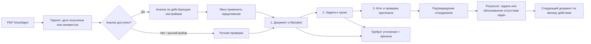

# PDF Eingang — новый интерфейс и процесс проверки

Дата: 28.10.2026. Статус: согласовано пользователем для реализации 28.10.2026 с использованием штатного UI Frappe.
Основной пользователь: один сотрудник последовательно разбирает очередь.
Язык интерфейса: немецкий; пояснения в этом документе — русский.

## Что изучено

- `kanzlei_erp/kanzlei_erp/page/posteingang/posteingang.js` и `.css`: рабочая страница, три панели, адаптивность, редактор, диалоги.
- `kanzlei_erp/public/js/posteingang_{intake,workspace,review,matching,jobs}.bundle.js`: загрузка, клиентское состояние, операции.
- `docs/posteingang.md`: действующий процесс, ограничения, восстановление, исправления.
- `kanzlei_erp/posteingang_review_validation.py`: обязательные решения и основания подтверждения.
- UI UX Pro Max: дизайн-система, enterprise document layouts, progressive disclosure, labels, inline validation, focus и контраст.

Доступный браузер открывает локальную ERP на форме входа. Аудит текущего
интерфейса основан на реализации и документации, без утверждения о проведённом
живом сценарии в ERP. Прототип использует исключительно синтетические данные.

## Почему сейчас непонятно

| Наблюдение в реализации | Последствие | Решение |
| --- | --- | --- |
| На большом экране одновременно очередь, PDF и длинный редактор | Три конкурирующих центра внимания; мало места оригиналу | Очередь как отдельный стартовый экран; проверка в двух колонках |
| Анализ, ручной режим, применение результата и подтверждение представлены отдельными равнозначными командами | Нужно знать внутреннюю модель процесса | Один следующий шаг в текущем состоянии; технические команды во вторичном меню |
| Для каждого действия всегда видны причины отказа, отсутствия исполнителя и отсутствия даты | Исключения занимают больше места, чем обычная работа | Показывать поля только после соответствующего решения |
| Сначала длинная форма, затем checkbox и дополнительный modal preview | Итог трудно найти и проверить | Отдельный заключительный этап с полным результатом |
| Внешняя дата, предложение AI и внутренняя дата расположены в одной длинной форме | Разные значения легко перепутать | Два явно названных блока со своим назначением |
| В очереди много технических строк: ID, возраст, статусы, кандидаты, ошибки | Трудно понять, с чего начать | Название письма, Mandant, состояние и следующее действие; подробности по запросу |
| На узком экране вкладки Queue/PDF/Human review скрывают контекст | Проверка источника требует переключения без ясного возврата | Оригинал открывается в контексте текущего шага, состояние и фокус сохраняются |
| Для исключений и конфликтов используются общие уведомления и диалоги | Непонятно, что сохранено и что делать дальше | Контекстное сообщение с конкретным действием и сохранением ввода |

Это экспертные выводы из кода, а не результаты пользовательского исследования.

## Три подхода

1. **Очередь + направляемая проверка — рекомендуемый.** Отдельная очередь,
   затем PDF рядом с тремя этапами. Сотрудник видит один понятный следующий
   шаг. Дополнительный переход между очередью и документом окупается читаемым
   оригиналом и короткими формами.
2. **Почтовый клиент с тремя постоянными панелями.** Быстрое переключение для
   опытного оператора, но на обычном ноутбуке очередь съедает ширину, а форма
   остаётся сложной. Подходит как последующая компактная опция для больших экранов.
3. **Kanban по состояниям.** Хорошо показывает общий поток нескольких
   сотрудников, но одному оператору добавляет перемещения и не помогает
   проверить документ и сроки. Сейчас не нужен.

## Основная модель

Сотрудник отвечает на три вопроса:

1. Что это за письмо и к какому клиенту оно относится?
2. Что нужно сделать, кому и когда?
3. Что именно будет создано после подтверждения?

Видимые этапы: **Dokument & Mandant → Aufgaben & Fristen → Abschluss**.
Загрузка и техническая обработка находятся до проверки, результат — после неё.
Этапы описывают рабочую сессию, а не заменяют серверные статусы Letter/Run.

## Экран очереди

Заголовок **PDF Eingang**; описание «PDFs prüfen und Aufgaben vorbereiten».
Одна основная кнопка **PDF hinzufügen**. Вместо панели фильтров на полэкрана:
поиск и рабочие представления **Zu prüfen**, **In Verarbeitung**, **Klärung**,
**Erledigt**. По умолчанию — документы, которые требуют действия человека.

Строка: понятное название, отправитель/имя файла, Mandant или «Noch zuordnen»,
дата загрузки, текстовый статус, **Prüfen**. Технический ID — в подробностях.
Фильтр «загружено мной» убирается из основного вида для одного сотрудника.
История включает завершённые и отменённые документы с различимыми статусами.

Сортировка по умолчанию: самые старые незавершённые. Фильтры и позиция
восстанавливаются после выхода из документа. Не менять порядок под курсором
при обновлении очереди. Счётчики должны считать все доступные записи на сервере,
а не только загруженную страницу; при отсутствии такого API счётчики скрыть.

Не сортировать по AI-срокам как по подтверждённой срочности. При необходимости
показывать «Datumsangabe erkannt · ungeprüft». Отдельная дата загрузки не
подменяет юридически значимую дату получения.

Пустая очередь: «Alles geprüft» + действие добавления PDF. Пустой поиск:
«Keine passenden Dokumente» + сброс поиска. Ошибка чтения не выглядит как
пустая очередь.

## Добавление PDF

Небольшой диалог с drag-and-drop и полноценной кнопкой выбора файлов.
Разрешены несколько файлов; лимиты берутся из серверных настроек.

- После выбора — строки файлов, размер, дата получения и индивидуальный результат.
- Дата получения изначально **Unbekannt**. Общая дата применяется ко всей пачке только явно.
- **Hochladen** запускает приём. Загрузка не создаёт задачи.
- Обработка после приёма следует текущим разрешениям и настройкам auto analysis.
- При выключенном auto analysis: **Analyse starten**; ручная проверка доступна рядом.
- Во время анализа — этап и время начала, без выдуманных процентов и обещания времени.
- Дубль: «Bereits vorhanden» + **Vorhandenes Dokument öffnen**; не запускать повторный анализ.
- Ошибка одного файла не отменяет остальные; повтор относится только к ошибочному файлу.
- Неизвестный результат: **Uploadstatus prüfen**, с тем же ключом запроса.

Сотрудник может закрыть диалог и продолжить работу, пока принятые документы
обрабатываются. Состояние загрузки в браузере и подтверждённый сервером приём
должны отображаться по-разному.

## Рабочий экран проверки

Верх: **Zur Übersicht**, название документа, текст состояния сохранения.
Ниже — три этапа с текущим положением; завершённые доступны для возврата.
Слева оригинал, справа текущая короткая форма. Нижняя панель относится только
к форме: **Entwurf speichern**, **Zurück**, одна основная кнопка следующего шага.
**Klärung erforderlich** — вторичное действие, отмена документа — в меню.

На широком экране PDF получает примерно 46–50% ширины. На ноутбуке сохраняются
две колонки без постоянной очереди. PDF и форма имеют независимую прокрутку;
панель действий не перекрывает последнее поле или фокус. В макете прокруткой
управляет поверхность предпросмотра; поведение прокрутки продукта задаётся здесь.

Если предложение ещё не применено, показать ясный промежуточный экран:
«Analyse bereit. Vorschläge prüfen und in den Entwurf übernehmen» +
**Vorschläge übernehmen**. Это явная операция текущего API, без автоматического
merge и без отметки человеческой проверки. Новый анализ поверх отредактированного
черновика требует отдельного решения; старый черновик сохраняется в истории.

### Этап 1 — Dokument & Mandant

Короткая карточка письма: отправитель, дата документа, тип и summary.
Полученная из анализа информация обозначена как предложение до проверки.
Данные можно исправить на месте. Дата получения отдельно, с явным «Unbekannt».

Кандидаты Mandant показывают имя, доступную отличительную характеристику и
объяснение совпадения с источником. Даже единственный кандидат не выбран.
**Diesen Mandanten auswählen** — явное решение сотрудника. Причина выбора
записывается в том же блоке: свободный текст или явно выбранное правдивое
основание «Kennung im Original geprüft». Нельзя автоматически утверждать,
что сотрудник проверил оригинал.

Поиск другого клиента встроен в этот блок. Кандидат без write access объясняет
ограничение. Несколько адресатов блокируют одно-клиентское подтверждение и
ведут к уточнению; интерфейс не обещает несуществующее разделение PDF.

**Speichern & weiter** сохраняет черновик явно и открывает этап 2 только после
успешного ответа. Возврат не теряет поля. Изменение Mandant при правках проходит
существующий save/discard guard; интерфейс сначала объясняет причину.

### Этап 2 — Aufgaben & Fristen

Сверху «Was muss erledigt werden?» и краткий список действий. В каждом:
заголовок, описание по раскрытию, ссылка на источник и решение
**Als Aufgabe übernehmen / Nicht erforderlich**. Все решения изначально pending.
Кнопка **Aufgabe ergänzen** создаёт ручное действие; исходные AI-действия
не исчезают, отклонённые остаются в компактном виде с причиной.

Для принятой задачи показывать только:

1. **Zuständig** — поиск сотрудника; явный вариант **Später zuweisen** раскрывает причину.
2. **Interner Arbeitstermin** — дата выполнения внутри канцелярии; вариант **Später planen** раскрывает причину.
3. **Frist aus dem Schreiben** — предложение из документа, источник, статус проверки и основание подтверждённой даты.

Выбор сотрудника сам заполняет `assignment_decision=assigned`; ввод внутренней
даты — `scheduling_decision=scheduled`. Не заставлять выбирать решение ещё раз
в отдельном select. Не назначать текущего пользователя и дату автоматически.

При отказе остаётся обязательная причина; блоки назначения и сроков сворачиваются.
Старые значения сохраняются локально до осознанной смены решения, а итоговый
payload нормализуется по серверному контракту.

Для внешнего срока:

- Явная дата: «Vorgeschlagen: 12.11.2026 · ungeprüft» + **Fundstelle ansehen**.
- Подтверждение даты и основания делает её подтверждённой; открытие источника само этого не делает.
- Относительный срок: показать исходную формулировку и пояснение «Datum selbst prüfen»; не вычислять его автоматически.
- Без даты: «Keine bestätigte externe Frist». Внутренний срок не подставляется во внешний.
- Ссылка ведёт на страницу оригинала. Если точные координаты отсутствуют, не имитировать точное выделение; цитата и номер страницы достаточны.
- Несопоставленная OCR-цитата явно отмечена как непроверенная.

Если все действия отклонены или их нет: отдельное решение
**Ohne Aufgaben abschließen**, причина и проверка оригинала. Пустой OCR или
ошибка анализа не означают «действия не нужны».

### Этап 3 — Abschluss

Показывать точный результат: Mandant, данные письма, принятые задачи,
исполнители, внутренние даты, подтверждённые внешние сроки и основания.
Отклонённые действия и причины доступны здесь же. Неполное планирование
явно помечается и не выглядит полностью готовой задачей.

У каждого блока **Ändern** возвращает на нужный этап. Перед окончательным действием:
**Ich habe das Original und alle endgültigen Entscheidungen geprüft**.
Любая последующая правка сбрасывает отметку.

Основная кнопка соответствует результату: **Bestätigen & 2 Aufgaben erstellen**
или **Ohne Aufgaben abschließen**. Число вычисляется по принятым действиям.
Новый отдельный modal preview не нужен: текущий этап уже является preview.

Если есть новый неприменённый Run, явное решение применить его либо сохранить
черновик с причиной находится до финального подтверждения. Оно не прячется
в неожиданном popup после нажатия основной кнопки.

## Результат

После подтверждённого ответа — «Schreiben abgeschlossen», список задач с
понятными названиями и ссылками, Mandant и доступ к оригиналу.
**Nächstes Dokument prüfen** и **Zur Übersicht**. Автоматически не переключать:
сотрудник должен увидеть результат. Подтверждение без задач имеет отдельный
положительный результат с причиной. Кнопка создания задач больше не активна.

Редактирование уже созданных задач происходит в обычном ERP Task.
Административное исправление документа — отдельное действие с причиной,
заменой и разбором старых задач; обычного «отменить создание» не обещаем.

## Состояния и восстановление

| Ситуация | Что видит и делает сотрудник |
| --- | --- |
| Анализ ещё не запущен | «Bereit zur Analyse»; запустить либо проверить вручную |
| Queued / Processing | «Wird vorbereitet»; можно открыть оригинал и дождаться результата |
| Ошибка анализа | «Automatische Analyse fehlgeschlagen»; ручная проверка, допустимый повтор, технические детали по раскрытию |
| Нужен Mandant / решение / дата / причина | Сообщение рядом с полем; внизу короткий список со ссылками на незавершённые места |
| Сохранение | «Wird gespeichert…», затем «Entwurf gespeichert · 14:32» только после ответа |
| Ошибка сохранения | «Nicht gespeichert»; поля остаются, доступен корректный повтор |
| Неполученный ответ mutation | «Ergebnis wird geprüft»; проверить и повторить то же намерение, не начинать новое |
| Конфликт ревизий | Сравнить локальную и сохранённую версии; без автоматической перезаписи |
| Выход с правками | «Speichern und verlassen / Verwerfen / Weiter bearbeiten» |
| Утрата прав | Удалить PDF и защищённые данные из экрана; объяснить, что доступ изменился |
| Функция отключена | Объяснить ограничение, сохранить разрешённое чтение истории и административные операции |
| Уточнение | Причина обязательна; явное возвращение к редактированию после разрешения вопроса |
| Коррекция | Отдельное состояние административной проверки; не показывать как обычный открытый документ |

## Визуальная система

Спокойный, точный рабочий интерфейс: светлый нейтральный фон, непрозрачные
поверхности, тёмный текст, один синий акцент. Зеленый — подтверждённый результат,
янтарный — внимание, красный — ошибка. Статус всегда содержит текст.
Без декоративных градиентов, стекла, «AI magic» и крупных сводных KPI.

Использовать текущий системный шрифт Frappe/Inter; не добавлять внешние шрифты.
Основной текст 14–16px, заголовок страницы 24px, заголовки секций 18px,
вторичные подписи не меньше 12px. Сетка отступов 4/8px, основные промежутки
16/24px; радиусы 8–12px, спокойные разделители вместо вложенных рамок.
Единая векторная библиотека значков, подписи у важных действий.

Предлагаемые светлые semantic tokens: canvas `#F6F7F9`, surface `#FFFFFF`,
text `#18232F`, text-secondary `#566575`, primary `#2454D7`, positive `#236447`,
attention `#85530A`, negative `#B42318`. Тёмная тема получает отдельные пары,
а не инверсию. Точные значения согласовать с общими токенами ERP.

Вывод UI UX Pro Max про enterprise gateway/landing hero и рекомендацию
glassmorphism не применять: это внутренний процесс, а не маркетинговый сайт.
Взяты релевантные принципы minimalism, semantic states, inline validation,
progressive disclosure, keyboard focus и читабельная плотность.

## Адаптивность и доступность

- От 1024px — PDF + форма; очередь отдельным экраном.
- 768–1023px — две колонки только если доступной ширины хватает; иначе контекстный переключатель оригинала.
- До 767px — одна форма, кнопка **Original ansehen**, возврат к тому же полю; без горизонтального скролла.
- 200% zoom рассматривается как узкий экран, поля и панели не перекрываются.
- Focus ring, обычный tab order, настоящие labels, статусные сообщения через live region.
- Ошибка submit переводит фокус к связанному summary; field errors остаются рядом с полями.
- Важные цели около 44px, действия не требуют hover или drag.
- Анимации только состояний, примерно 120–180ms; учитывать reduced motion.
- Контраст текста не ниже 4.5:1, значимых границ и фокуса — 3:1.

## Реализация по этапам после согласования дизайна

1. Новый layout очереди и двухколоночной проверки поверх текущего WorkspaceClient.
2. Три этапа и условные поля, явные save boundaries, видимые блокирующие причины.
3. Полный итог и экран результата, обработка конфликтов, ошибок и новых Run.
4. Адаптивность, локализация и короткий браузерный acceptance.

Сохраняются текущие API, expected_revision, request keys, guards, operator access,
приватный original, история и серверная валидация. UI stage — состояние навигации,
а не дополнительный серверный workflow. Если нужны глобальные счётчики, это
отдельное небольшое расширение queue API с проверкой прав на каждой выборке.
Автосохранение, новый механизм блокировок и распределение нескольких операторов
в эту версию не входят.

## Как проверить реализацию

Короткий основной сценарий: загрузить синтетический PDF → применить предложение →
явно выбрать Mandant с основанием → принять одну задачу → указать исполнителя
и внутреннюю дату → проверить внешнюю дату → проверить итог → подтвердить →
открыть созданную задачу и источник → вернуться к очереди.

Дополнительно по риску: отказ от действия; без задач; без назначения/даты с
причинами; неизвестная дата получения; дубли; ошибка анализа; несколько адресатов;
правка после checkbox; выход с dirty review; новый Run; conflict/unknown outcome;
утрата доступа; административная коррекция. Проверить 375px, 1024px и desktop,
немецкие подписи, клавиатуру и 200% zoom. Запускать тесты изменённых модулей,
не полный CI image build.

Критерий понятности для будущей короткой usability-сессии: сотрудник без
инструктажа находит следующий шаг, отличает внутреннюю дату от внешнего срока,
понимает момент создания задач и может отложить документ с причиной.
Это критерий будущей проверки, не уже измеренный результат.

## Границы интерактивного макета

Макет показывает очередь, явное применение предложения, выбор Mandant,
принятие/отклонение одной задачи, назначение и даты, финальную проверку,
результат и ветку уточнения. Он не подключён к ERP, не загружает PDF,
не вызывает провайдера и не создаёт Task. Оригинал изображён текстовым
синтетическим письмом. Остальные состояния специфицированы выше.

Сохранение состояния макета содержит только синтетические значения. В рабочую
ERP этот механизм не переносится: защищённый review buffer остаётся в памяти,
сохранение документа выполняется серверным API с текущими проверками.

## Проверка дизайн-макета

Проведена в Chrome 28.10.2026:

- Очередь → применение предложения → явная привязка Mandant с причиной → принятие задачи → исполнитель и внутренняя дата → подтверждение внешней даты с основанием → итог → демонстрационный результат.
- Переход без выбора Mandant блокируется; финальное подтверждение без human checkbox блокируется.
- Возврат к редактированию сбрасывает human checkbox.
- Просмотр источника сохраняет состояние полей и не подтверждает срок автоматически.
- Отказ от задачи с причиной → итог без задач → демонстрационный результат.
- На viewport 1024px ширина содержимого 977px и scrollWidth 977px; на 375px соответственно 328px и 328px. Горизонтального переполнения макета не обнаружено.
- Выполнен визуальный просмотр двухколоночного и узкого экранов; проверена генерация preview из HTML-фрагмента.

Интеграционные тесты ERP не запускались: рабочие модули не менялись.
Живой процесс существующей ERP, реальная загрузка, Task creation, серверные
ошибки, keyboard/screen-reader acceptance и тёмная тема в этой задаче не проверены.
