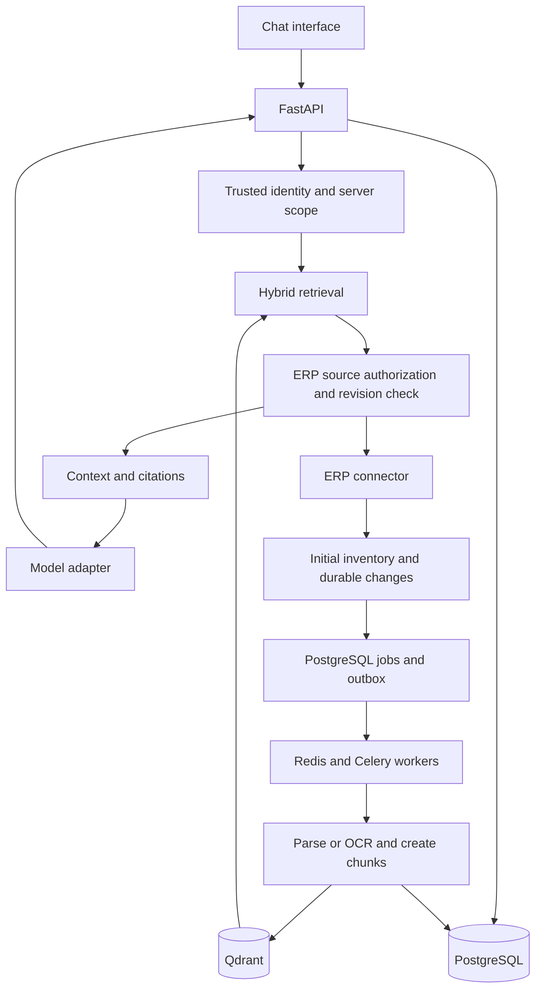

# Independent AI service architecture

**Status:** The user accepted the separate-service architecture, stack and asynchronous Drive processing flow. On 2026-11-15 the user selected a separate directory in this repository. The contracts below are the proposed engineering specification; implementation progress is recorded in the implementation plan.

**Goal:** Provide answers, summaries and drafts grounded in the Kanzlei's email and uploaded documents, either for one Mandant or across the user's permitted Mandanten.

## Scope and deployment boundary

The service lives in `services/kanzlei_ai/` and owns its dependencies, migrations, API, workers and deployment configuration. It imports no Frappe modules, reads no ERP database tables, and does not share ERP Redis credentials or database credentials. The same repository provides coordinated development without requiring coordinated application releases.

The ERP connector lives in `kanzlei_erp/ai_connector/`. It translates existing ERP entities and authorization into a versioned source contract. Original files and business records remain in ERP/Drive. The AI service creates no Tasks, sends no email and changes no accounting or workflow state. Drafts remain drafts in the chat.

The first vertical slice supports a synthetic, text-based PDF in one managed Mandant Drive folder. The complete first release also includes scanned PDFs, email with and without attachments, the general mode and summaries/drafts. External websites, Suite native editors, autonomous actions and an authoritative tax-law knowledge base are outside this release.

## Selected stack

| Responsibility | Selection |
| --- | --- |
| API and schema validation | Python, FastAPI, Pydantic, Uvicorn |
| Persistent application state | PostgreSQL, SQLAlchemy, Alembic |
| Search | Qdrant, dense vectors plus BM25, initial fusion using RRF |
| Background work | Celery and a dedicated Redis broker |
| Document extraction | Docling, with replaceable OCR adapter |
| Large derived artifacts | Private S3-compatible storage with a service-specific namespace |
| Initial deployment | Separate Docker Compose project; API and workers use the same application image |

Exact runtime, image and package versions are selected and locked after an ARM64 dependency smoke check. LLM, embedding, reranking and OCR providers remain replaceable. Provider/model selection is a separate decision before live-data use. Synthetic providers establish pipeline correctness, not model quality.

PostgreSQL is authoritative for source manifests, extracted-text provenance, jobs and conversations. Qdrant is a rebuildable search projection. Redis transports task IDs; it is not the only record of pending work. Existing original storage is accessed through the ERP connector, not by scanning a bucket.

## Existing integration points

- `kanzlei_erp/mandant_drive.py`: protected `kanzlei_drive_folder` and `kanzlei_drive_customer`, staff and Customer access.
- `kanzlei_erp/mandant_documents.py`: supported relationship graph, active Drive ancestry and current document access checks. Its current search covers metadata, not document bodies.
- `kanzlei_erp/navigation.py`: Communication permissions can arise through mailbox access or linked Mandanten; readable mail is not automatically in the selected Mandant scope.
- `kanzlei_erp/email_history.py`: historical linking preserves explicit references and skips ambiguous candidates. Existing email can have several Mandant links.
- `kanzlei_erp/object_storage.py`: `open_file` preserves managed storage checks.
- `kanzlei_erp/drive_realtime.py`: existing notifications are transient UI invalidations, not a durable integration change feed.
- `kanzlei_erp/posteingang_jobs.py`: existing OCR results are associated with a particular source snapshot and have additional access boundaries.

Do not expose private helper functions directly as the new API. Extract a documented policy boundary where needed and retain the existing consumers' behavior.

## Component flow

## Connector contract v1

Logical operations are transport-independent. The Frappe implementation uses whitelisted methods with explicit authentication and bounded pagination; clients use the connector adapter rather than Frappe's unrestricted generic resource APIs.

| Operation | Contract |
| --- | --- |
| `list_clients` | Clients permitted for the verified user; stable opaque IDs and display labels |
| `inventory` | Eligible sources, stable pagination and a change-feed watermark for initial synchronization |
| `changes` | Durable upsert/delete/relationship-change events after an opaque cursor |
| `read_source` | Current manifest and bytes/text for an expected revision; reject stale reads |
| `authorize_sources` | Batch decisions for the verified user, chosen scope, source IDs and revisions |
| `read_work_context` | Bounded, permission-checked structured ERP queries; no arbitrary SQL |

Source identity is `(connector_id, source_id)`. Manifests include `source_type`, `revision`, `content_hash` when available, `client_ids`, `title`, `mime_type`, `source_modified_at`, `locator`, `active` and processing eligibility. `client_ids` is a set, not one mandatory scalar. Chunk locators include page and span for documents, or message ID for mail. Dates of upload, email and document content remain distinct.

The contract also declares processing policy and supported formats. Unlinked mail is excluded from the initial corpus; adding a separate unassigned-mail scope requires a later explicit decision. HTTP links are references, not permission to crawl their destinations. Folder membership requires an active path under the verified Mandant root, not just a matching File marker.

Service credentials authorize configured ingestion only. They do not prove which human is asking a question. User-facing operations require a trusted, expiring user identity bound to the service and mapped to ERP. Resolve the initial login handoff in the connector-contract task; never trust a browser-supplied role, email or `user_id`, or expose a free-form impersonation endpoint. Anonymous fake identities are permitted only with synthetic fixtures in an isolated development configuration.

## Durable synchronization

1. Write an integration event in the same ERP database transaction as the source change. Rollback produces no visible event. Network calls and OCR are outside that transaction.
2. Expose committed changes with a cursor protocol that cannot skip a late-committing transaction. A naive auto-increment ID or `modified > last_seen` is insufficient. Test reversed commit ordering; use a serialized transactional sequence/watermark or another demonstrably safe feed implementation.
3. The service atomically saves received events, jobs, dispatch-outbox entries and its cursor in PostgreSQL. Duplicate deliveries are harmless.
4. A dispatcher submits task IDs to Celery. Recovery reconciles pending jobs and expired worker leases against durable state.
5. Initial inventory and feed overlap deliberately, with idempotent application. A periodic inventory reconciliation catches missed ancestry/content/relationship changes and revoked processing eligibility.

Changes include content replacement, trash/restore, deletion, Mandant links, relevant ancestor state and storage rebinding. Some existing paths use direct database updates; connector coverage must inspect those mutation paths rather than assume every change fires `on_update`. Permission changes take effect through current authorization even before the index catches up.

## Processing and publication

The pipeline is `queued -> fetching -> parsing/OCR -> embedding -> indexing -> ready`, with explicit retryable and terminal errors. Checkpoints are keyed by source revision and parser/OCR/embedding versions. Bound file size, page count, CPU/memory, provider requests and attempts. Processing eligibility is checked before external processing and again on resumed work.

For a PDF, preserve usable native text; use OCR when extraction is inadequate. Preserve tables and page provenance when chunking. Email processing preserves message boundaries, participants, direction and reply relationships, removes redundant quoted copies conservatively and keeps messages without attachments. Retrieval of a thread reauthorizes every expanded message.

Workers use source-specific leases and generation fencing. Write new Qdrant points under a new generation, then conditionally activate that generation in PostgreSQL only while it is current. Search validates results against the active manifest; it does not assume a cross-database transaction. Failed or superseded generations are invisible and cleaned up later. Deletion tombstones invalidate results immediately at the authoritative checks and schedule derived-data cleanup.

Reusing identical extracted content does not merge source membership or authorization. A duplicate file attached to a different record remains a separate source. Retrying after a crash may repeat an external request; checkpoints reduce repeats but do not promise exactly-once provider billing.

## Query and history boundaries

Each conversation has an immutable scope: one client or the general Kanzlei mode. Selecting another scope opens another conversation. General mode requires a separate connector-approved permission and still intersects with current source rights. Search filters are applied before retrieval; retrieved sources are reauthorized before any external reranker, context assembly or generation. Refuse a grounded answer when ERP authorization is unavailable.

Do not pass old assistant messages blindly back to the model. Persist the source/revision dependencies of answers and summaries, and recheck them before displaying or reusing history. Redact/invalidate content dependent on a source the user can no longer read, including derived summaries. Historical source versions need an explicit authorized retention policy; otherwise require regeneration from current versions.

The model receives data, not operational authority, from documents. Citations must map to actual authorized fragments. Unsupported questions produce an explicit lack-of-evidence answer. Conflict between sources is preserved with dates and provenance. Model-generated statements are not automatically established facts.

Questions requiring exhaustive lists, counts or current workflow state use bounded structured ERP queries. Top-k retrieval cannot establish completeness across all Mandanten. Show indexing failures and lag as coverage limitations; do not claim every document was searched when processing is incomplete.

## First milestone and follow-up

**First milestone:** On an isolated local fixture, upload a text PDF under client A, observe readiness, ask in client A's chat, and open a cited page in the original document. The PDF must be absent from client B's context and from an unauthorized user's output. Restarting workers must not lose processing state. Trash, replacement and access revocation must prevent stale content from being used.

Follow with scanned PDF/OCR evaluation, email and attachments, general mode, structured work context, broader file formats and pilot operations. The UI is independently served; an ERP shortcut can launch a scoped conversation later. Its initial frontend framework and the login handoff are resolved before the browser milestone.

Acceptance uses synthetic documents first. A small German fixture set must distinguish exact facts, semantic matches, contradictions, tables, prompt injection and unanswerable questions. Real model quality and real-document processing are separate from mocked integration acceptance. The task owner creates the PR and deploys.

## Technical references

- [FastAPI streaming](https://fastapi.tiangolo.com/tutorial/server-sent-events/)
- [PostgreSQL JSON types](https://www.postgresql.org/docs/current/datatype-json.html)
- [Qdrant hybrid queries](https://qdrant.tech/documentation/search/hybrid-queries/)
- [Celery task retries and delivery](https://docs.celeryq.dev/en/stable/userguide/tasks.html)
- [Docling formats](https://docling-project.github.io/docling/usage/supported_formats/)
