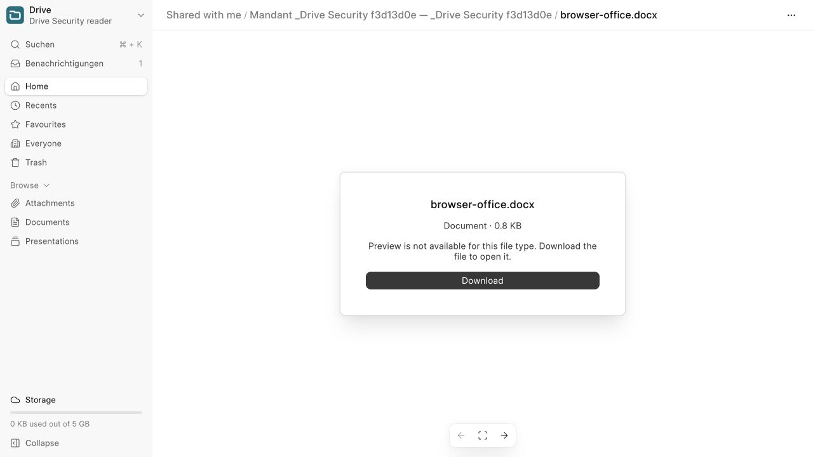

# BL-044 — приёмка скачивания файлов и ZIP

Дата: 13 октября 2026. Ветка: `codex/drive-downloads`, база — merged main `b279be304aceae10b3d3e52e4c6ed829ab8f47fe`.

## Результат

Загруженные DOCX/PPTX/XLSX/PDF/XML скачиваются с исходными байтами и входят в ZIP. Загруженные Office-файлы открывают локальную карточку File с именем, типом, размером и кнопкой скачивания. Microsoft iframe удалён, Office-token для карточки не создаётся. Writer/Sheets/Slides сохраняют свои редакторы; их экспорт не добавлен.

Общий классификатор учитывает сохранённую связь содержимого, папку, URL и legacy MIME встроенных документов. `can_download` вычисляется перед маскировкой storage URL и управляет кнопками; сервер повторно проверяет права. Storage URL загруженных презентаций скрыт. PDF, изображения, текст и CSV сохраняют локальные предпросмотры.

ZIP обходит доступные элементы рекурсивно, сохраняет иерархию, устраняет пересечение выделений и коллизии имён, включая совпадение файла с папкой. Явно выбранный доступный файл не теряется за недоступной промежуточной папкой. Ошибка чтения завершает сборку с `failed` и удаляет частичный локальный архив; S3 получает только законченный ZIP. При отсутствии файлов API объясняет отказ.

`download_folder` и `download_status` возвращают `skipped_counts={hosted_content,links}`. Повторная выдача проверяет текущие права на пропущенные элементы; их имена и пути клиенту не передаются. Realtime сообщает только token/status/size или безопасную ошибку; клиент перечитывает статус через API. Manifest версии 2 и fingerprint состава/ревизий исключают старые неполные архивы. Старый token требует повторной сборки; штатная TTL-очистка сохраняется.

## Проверки

Использованы настоящие минимальные OOXML-пакеты DOCX/PPTX/XLSX, PDF и XML на искусственных данных. До исправления тесты воспроизвели отказ Office, неполный ZIP, отсутствие capability, старый manifest и коллизии. Дополнительные красные регрессии воспроизвели истёкший cache token, потерю отдельно доступного потомка и нераспаковываемый ZIP при совпадении файла с папкой; после исправления прошли.

| Проверка | Результат |
| --- | --- |
| `kanzlei_erp.tests.test_drive_downloads` | 18 тестов прошли: исходные байты, списки/карточка, overlap/имена/вложенность, Writer и ссылки, свежие предупреждения, отсутствующие байты, отзыв доступа до/после готовности, ERP-вложение, S3, старый/истёкший cache, изменившаяся папка и storage-alias. |
| Полный Kanzlei в собранном образе | 205 интеграционных + 21 модульный тест; CI проверил 226 XML-результатов без ошибок. |
| Suite API и archive | 49 + 2 теста прошли. Два archive-мока перенесены на фактический provider прав общего классификатора. |
| Drive Vitest | 93 теста в 13 файлах прошли: оба openEntity, ссылки/new-tab, toolbar/navbar/card, смешанное выделение, предупреждения, отказ при отзыве и отсутствие Microsoft preview/token. |
| Root Node | 12 тестов прошли. |
| Deployment | 34 теста прошли, включая clean/repeat, v1/v2 upgrade, конфликт и точный откат обоих приложений с сохранением посторонних изменений. |
| Реальные Suite-патчи | Чистые закреплённые исходники, exact v1 → current и exact v2 → current прошли; reverse-check повторного применения прошёл. v2 побайтно совпадает с патчем main перед BL-044. |
| Assets / образ | Production Suite assets и полный Docker image build прошли. |
| Статический контроль | F/B lint новых Python-файлов и обновлённых root-сценариев, shell/Node syntax и root/dependency diff checks прошли. |

HTTP/Socket.IO-сценарий `scripts/verify-drive-security.py` расширен и включён в существующий CI образа. Четыре обычных System User (writer/reader/stranger/revoked) проверяют multipart-загрузку всех пяти форматов в обычную и Mandant-папку. SHA-256 исходника, прямого ответа и записи ZIP совпадает; выбор папки вместе с её файлами не дублирует записи. Смешанный ZIP содержит файлы и сообщает пропуски Writer/ссылки. Посторонний сотрудник получает отказ, а ZIP, подготовленный до отзыва прав, больше не выдаётся. Сохранены HTTP/WebDAV, preview-token, realtime и стандартные File API-проверки BL-042–043. XML MIME допускает эквивалентные `text/xml` и `application/xml`.

В браузере обычный сотрудник с чтением открыл DOCX из списка: маршрут `/drive/f/<id>`, локальная карточка и кнопка Download. Скачивания из контекстного меню списка и карточки получены браузером; SHA-256 обоих совпал с загруженным исходником. В карточке нет iframe и внешних Office DOM-ресурсов. Все искусственные browser users/Customer/File удалены, настройки WebDAV восстановлены и временный файл credentials удалён.

## Образ и выпуск

Suite закреплён на `2db13737524b271e32cae80a64a85b5ff112e55f`; основа образа — закреплённый `frappe/erpnext:v16.36.1`. Образ `kanzlei-downloads:local` для `linux/arm64`, ID `sha256:f3ab0d100d5c0b651102bfe734aa0b75445132132da8e0799aea314efff2b9be`.

Полный `PLATFORM=linux/arm64 bash scripts/ci-image.sh kanzlei-downloads:local` завершился с exit 0: 226 application-результатов, HTTP/Socket.IO под четырьмя сотрудниками с Office/ZIP, 12 Node-тестов, fresh/repeat install и migrate, оба legacy-verify, PDF upload/download, реальный backup/restore базы и публичных/приватных файлов, итоговые smoke checks. Одноразовые контейнеры и volumes удалены штатно.

Изменения Suite сохранены в `deploy/suite-mandant-access.patch`; `suite-mandant-access-v2.patch` — точный предыдущий security-патч. Установщик предварительно проверяет оба приложения, поддерживает v1/v2 и откатывает точные предшественники без reset чужих изменений. Новых полей и миграции File нет.

Production-деплой — отдельный выпуск: штатный backup, проверка существующих storage-alias, согласованное обновление backend/Suite assets, migrate, build, clear-cache и перезапуск backend/workers/websocket. Образ в registry не опубликован.

## Границы

- S3 проверен моками фактических ключей и байтов; внешний production bucket не использован. Срок действия уже выданных presigned URL не изменён.
- Встроенные документы и ссылки пропускаются с предупреждением; экспорт Writer/Sheets/Slides не входит в этап.
- BL-045–049 остаются открытыми. BL-050 расширен только сценариями скачивания; ERP-меню, Mandanten и Customer-форма ждут своих этапов.
- Изменения находятся в рабочей ветке без нового commit/push/PR. Предшествующие изменения `.gitignore` и transactional-email сохранены.
