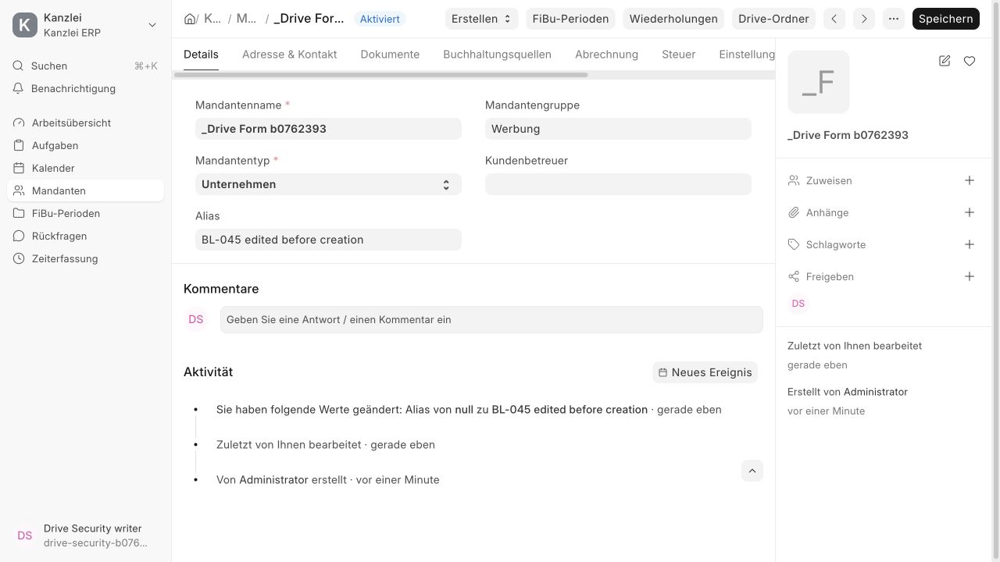
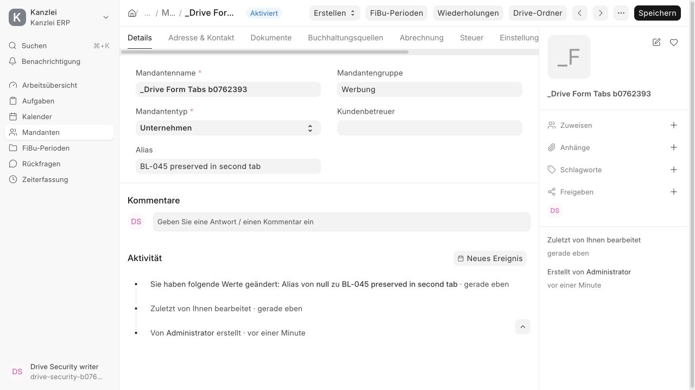

# BL-045 — синхронизация карточки Mandant с папкой Drive

Дата: 13 октября 2026. Ветка `codex/drive-downloads`, поверх проверенного BL-044.

## Результат

Форма синхронизирует только `kanzlei_drive_folder` после первоначального получения, создания и повторного открытия папки. Использован штатный `frm.set_value` с `skip_dirty_trigger=true`: введённые реквизиты и dirty-state сохраняются, modified не подменяется, документ не перезагружается и автоматически не сохраняется. После создания кнопка немедленно меняется на Drive-Ordner / Папка Drive. Заблокированный popup не отменяет синхронизацию.

Асинхронный `before_save` существующей карточки с пустой связью ожидает текущую операцию создания, перечитывает `get_folder` и синхронизирует связь до отправки Customer. При отсутствии Suite или папки обычное сохранение продолжается; ошибка обязательной проверки останавливает текущую попытку, сохраняя данные формы.

Каждая операция привязана к объекту документа, его имени и текущему маршруту ERP. Поздний ответ не редактирует другую или заменённую карточку. Старый пустой ответ не стирает известную папку. Promise rejection останавливает только свою цепочку сохранения; глобальный `frappe.validated` не изменяется.

Контракт `get_folder` / `create_folder` и схема БД не менялись. Защита служебной связи и реальные конфликты modified остаются строгими. Suite/Frappe-патчи BL-044 не изменены этим этапом.

## Найденная серверная гонка

Два настоящих HTTP-запроса создания воспроизвели MariaDB 1020 `QueryDeadlockError` при блокировке Customer. Локальная MariaDB использует `innodb_snapshot_isolation=ON`, `REPEATABLE-READ`: после commit другого создателя текущий snapshot уже устарел. Чтение Customer сразу с FOR UPDATE исключает устаревшее перечитывание документа, но само ожидание блокировки также может завершиться 1020.

Добавлены максимум три попытки первичного блокирующего чтения. Повтор откатывает snapshot и заново проверяет System User и Customer write permission. Он выполняется до FileManager, создания папки, установки ContextVar и изменения Customer. Ошибка после начала storage-операций не повторяется; третья ошибка блокировки возвращается вызывающему коду. В production функция вызывается отдельным whitelisted endpoint. Две серверные регрессии воспроизвели отсутствие повторения и повторной проверки прав до исправления; после исправления прошли.

В cleanup искусственных фикстур используется NULL для уникального поля связи, а ID корней сохраняются до её сброса. Это позволяет корректно удалять несколько тестовых Customer и их папки.

## Проверки

| Проверка | Результат |
| --- | --- |
| Клиентские регрессии до исправления | 14 ожидаемых отказов: отсутствующая синхронизация/проверка перед сохранением и поздние ответы. |
| Навигационные регрессии из ревью | Ещё три красных сценария: маршрут изменился до замены frm.doc, уход со страницы и ошибка старого сохранения во время нового. После исправления зелёные. |
| `tests/mandant-drive.test.cjs` | 22 теста прошли: clean/dirty, initial/create/reopen, another-tab save, ожидание текущего создания, double click, popup, out-of-order, навигация/замена документа, network/access failure, new form и отсутствие Suite/папки. |
| Весь root Node | 30 тестов прошли. |
| `kanzlei_erp.tests.test_mandant_drive` | 27 тестов прошли, включая пять новых: stale snapshot → sync → save, запрет clear/forge, настоящий timestamp conflict, snapshot retry и свежие права. |
| HTTP / Socket.IO | Полный сценарий под четырьмя System User прошёл. Параллельные writer create возвращают один ID; отдельная проверка БД подтверждает одну папку. Customer сохраняет реквизиты после синхронизации; пустая/подменённая связь и устаревшие реквизиты отклоняются. Сценарии Office/ZIP, SHA-256, realtime, token, alias и WebDAV BL-044/042–043 сохранены и прошли. |
| Assets / образ | Production Kanzlei assets и итоговый image build прошли. |
| Статические проверки | Python F/B, Node syntax и git diff checks прошли; добавлены переводы сообщений на немецкий и русский. |
| Ревью | Независимое requesting-code-review выявило два дефекта lifecycle; они исправлены и повторно проверены. Замечаний к финальному backend-повтору и HTTP-проверкам нет. |

Полный `PLATFORM=linux/arm64 bash scripts/ci-image.sh kanzlei-form-sync:local` завершился с exit 0. В образе прошли 210 интеграционных и 21 модульный тест Kanzlei; проверены 231 XML-результат. Также прошли HTTP/Socket.IO-приёмка с параллельным созданием, 30 Node-тестов, fresh/repeat install/migrate, оба legacy-verify, PDF upload/download, реальный backup/restore базы и публичных/приватных файлов и итоговые smoke checks. Одноразовый стек CI удалён штатно.

## Браузерная приёмка

Обычный сотрудник с Customer write access открыл искусственный Mandant без папки, ввёл Alias, создал папку и сохранил форму. Между созданием и сохранением Alias остался в форме и статус был «Не сохранено»; после нажатия Save появились «Сохранено», кнопка Drive-Ordner и запись истории Alias. Перезагрузки страницы не было.

Для второго искусственного Mandant открыты две вкладки до создания папки. Во второй введён Alias. Первая создала папку, затем вторая сохранила свои данные без reload и без ошибки защищённой связи; кнопка стала Drive-Ordner. База отдельно подтвердила оба Alias и ровно один управляемый root для каждого Customer.

Все временные браузерные вкладки закрыты. Фикстуры удалены штатным cleanup, настройки WebDAV восстановлены, временный файл credentials удалён. Отдельная проверка базы подтвердила отсутствие искусственных пользователей и Mandanten этих сценариев. Искусственные адреса на скриншотах не являются рабочими учётными записями.

## Образ и выпуск

Образ `kanzlei-form-sync:local` для `linux/arm64`, ID `sha256:d495cb3f3057157242b38cb2bb863a1a163fb10ce10ee4cbe9147e61ef228bfe`. Содержит BL-044 и BL-045. Suite закреплён на `2db13737524b271e32cae80a64a85b5ff112e55f`; base image — закреплённый `frappe/erpnext:v16.36.1`.

Новых полей, миграции File/Customer и изменений dependency-патчей не потребовалось. Production-выпуск выполняется отдельно с backup, штатным migrate/build/clear-cache и перезапуском сервисов. Коммит/push/PR пока не выполнялись; существующие изменения BL-044, `.gitignore` и transactional-email сохранены. BL-046–049 остаются открытыми; BL-050 расширен сценариями карточки и параллельного создания.
