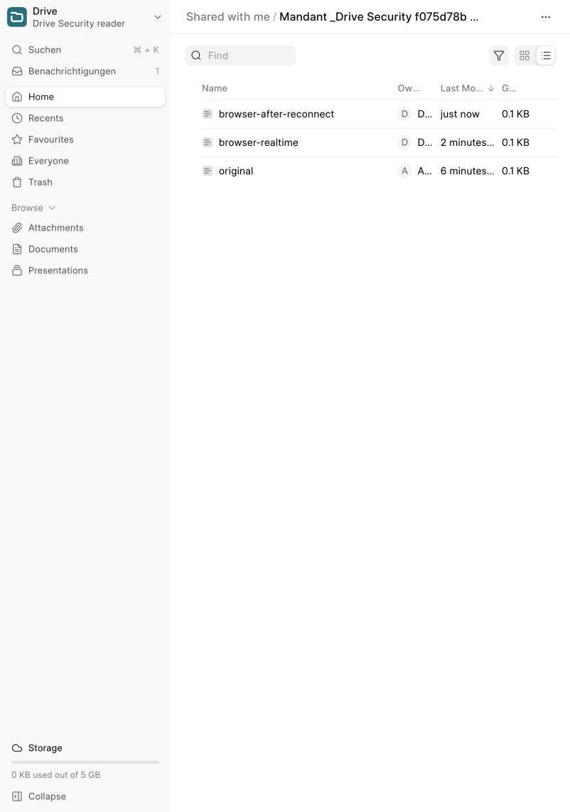

# BL-042–043 — проверка защиты Drive

Дата: 13 октября 2026. Объём: BL-042 и BL-043; BL-044–049 и полная BL-050 остаются открытыми. Основание: [утверждённый план](../plans/2026-10-13-drive-security-implementation.md).

**Статус:** BL-042 и BL-043 выполнены. Серверные, клиентские, HTTP/браузерные проверки и полный CI образа прошли. Production не изменялся.

## Что реализовано

Общий resolver сопоставляет сохранённые File с физическими объектами. Он учитывает локальные канонические пути и symlink, S3-wrapper, управляемые каталоги, thumbnail и trash. Независимый File не может присвоить защищённый объект даже при текущем доступе его владельца к Mandant. Ранее сохранённые aliases исключены из списков/прав и блокируются до I/O. Исходный и целевой объекты проверяются отдельно; отказ не удаляет оригинал при rollback.

Новые storage-ключи разрешаются только узким серверным контекстом конкретной записи и ключа. JSON-флаги, `ignore_validate` и подставное имя до autoname не дают этого разрешения. Стандартный серверный `save_file()` и разрешённое копирование обычных ERP-вложений работают; для attachment-copy проверяются исходный File и целевой документ. Управляемое копирование создаёт отдельный объект. Проверки не создают ленивый корень Drive и не кэшируют права Customer.

После commit сервер вычисляет получателей заново и отправляет `drive-folder-changed` с единственным полем `folder` в комнаты пользователей. Клиент перечитывает список через обычный API, объединяет близкие сигналы, сохраняет фильтры/сортировку, отбрасывает поздний ответ после навигации и удаляет подписку при размонтировании. Отказ по правам очищает недоступный список; временная сетевая ошибка сохраняет данные. Повторные запросы индекса в WebDAV batch устранены.

## Аудит событий

| Канал | Результат |
| --- | --- |
| `list-add` | Глобальная отправка File заменена адресным сигналом после commit. |
| `list-update`, `list-remove`, `client-rename` | Серверных отправителей в проверенном Drive нет; клиент больше не применяет эти payload к списку. |
| `drive-folder-changed` | Только folder ID; текущие права на папку/объект, включённые System Users, дедупликация транзакции. Rollback не отправляет сигнал. |
| Frappe `doc_update`, `list_update` для File | Общие комнаты перехвачены. Разрешённым пользователям направляются только doctype, ID и modified. |
| File `docinfo_update` / комментарии | Адресная invalidation; Desk перечитывает docinfo с проверкой прав, не перезаписывая несохранённые поля формы. |
| `doc_viewers` | Перед каждой отправкой проверяются права каждого текущего socket; ранее подписавшийся отозванный пользователь исключается. |
| `drive-download-status` | Адресно; повторная проверка прав, безопасный общий текст ошибки без путей и содержимого traceback. |

## Проверки

| Проверка | Фактический результат |
| --- | --- |
| Весь `kanzlei_erp`, локальный Bench | 187 интеграционных + 21 модульный тест прошли в одноразовом CI; XML проверен отдельно: 208 результатов без failures/errors/skips. Локальный полный прогон до последнего S3-теста: 186 + 21, без ошибок. |
| `test_drive_storage_security` | 26 тестов прошли: создание/изменение alias, отзыв владельцу, старые aliases, канонические пути/symlink, sidecar, rollback, ERP copy, rename/trash/restore с занятым именем, spoofed ID, ignore_validate, копирование подпапки. |
| S3 без внешнего backend | Сохранение семантики slash, правильный декодированный ключ разрешённой загрузки; отклонённые read/upload/delete/move не вызывают backend. |
| `test_drive_realtime` | 3 теста прошли в полном локальном наборе: адресация, свежие права после отзыва до commit, rollback. |
| Штатные Suite upload/API | 49 тестов прошли. Моки настроек дополнены thumbnail_prefix; негативное ожидание допускает ранний PermissionError Kanzlei. Worker/scheduler временно приостановлены и автоматически возобновлены. |
| Штатный Suite WebDAV batch | 4 теста прошли, включая постоянное число SQL-запросов для 60 детей и эквивалентность обычным правам. |
| Suite Vue/Vitest | 14 тестов прошли: GenericPage и coalescing/subscription helper. |
| Root Node | 12 тестов прошли, включая реальный patched File presence и безопасный docinfo refetch. |
| Deployment Python | 28 тестов прошли в итоговом полном прогоне, включая успешный/repeat переход, откат обеих старых версий при конфликте второго приложения и отказ от неизвестной первой версии без изменений checkout. |
| Патчи | Применение к чистым закреплённым исходникам, повторная reverse-check проверка, переход exact v1 → current прошли для Frappe и Suite. |
| Статический контроль | Python F/B lint, shell syntax, Node syntax, root и actual dependency `git diff --check` прошли. |
| Read-only alias audit | На локальном сайте конфликтов не обнаружено; рабочих записей не исправляли. |

Сквозная HTTP/Socket.IO-приёмка `scripts/verify-drive-security.py --site development.localhost --fixtures` прошла с четырьмя независимыми обычными System User: writer, reader, stranger и revoked. Проверены прямое скачивание старого alias, WebDAV GET/PROPFIND, стандартный File API, ID-only события, отсутствие File metadata и presence у постороннего/отозванного, скачивание и ранее выданный cookieless preview token после отзыва, разрешённое перечитывание списка.

В браузере сотрудник **Drive Security reader** открыл папку по правам Customer. Другая HTTP-сессия писателя загрузила `browser-after-reconnect.xml`; файл появился в открытом списке без перезагрузки. Для Docker development исправлены разрешение site hostname внутри контейнера и общий developer mode, чтобы websocket обращался к внутреннему порту Bench при browser Origin с внешним портом. Все тестовые users, Customer и File удалены; настройки WebDAV восстановлены, файл временных credentials удалён. Пароли/cookie в отчёт не включены.

## Образ и выпуск

Основа: `frappe/erpnext:v16.36.1` с закреплённым digest из Dockerfile; Suite `2db13737524b271e32cae80a64a85b5ff112e55f`. Сборка выполняется локально для `linux/arm64`. Полная приёмка включает свежую установку и повторную миграцию, полный набор Kanzlei, переход существующего ERP-сайта на Suite с сохранением Customer/вложения, реальный backend/websocket, HTTP-сессии сотрудников, PDF upload/download и backup/restore базы и публичных/приватных файлов.

Приёмочный образ `kanzlei-security:local`, image ID `sha256:b9e639f86fcd7a4e58f613dfe32cf6413c4d678cdf1f956483f4e7d9afc1f4b6`, собран и прошёл полный `PLATFORM=linux/arm64 bash scripts/ci-image.sh kanzlei-security:local` (exit 0). CI подтвердил 208 application-результатов, 12 Node-тестов, HTTP/Socket.IO под четырьмя сотрудниками, обе проверки legacy-вложения, PDF upload/download и backup/restore. После сборки добавлен только откат пары патчей в build-time installer, проверенный отдельными сценариями; runtime-код приложения и зависимостей соответствует принятому образу. Образ локальный, в registry не публиковался.

Установщик поддерживает только точный предыдущий патч: при конфликте любого из двух приложений восстанавливает исходное состояние обоих патчей и сохраняет посторонние изменения checkout. Регрессия воспроизведена до исправления: конфликт Suite оставлял Frappe на новой версии. После исправления тест восстанавливает обе v1 и сохраняет пользовательский конфликтующий файл.

Перед выпуском: обычный backup, read-only `bench --site <site> execute kanzlei_erp.drive_storage.audit_storage_aliases`, ручной разбор найденных конфликтов, согласованное применение обоих патчей, migrate/build Suite и Kanzlei, clear-cache и перезапуск backend/workers/websocket. Схема и существующие связи не мигрируются.

## Ограничения

- Уже законно выданные S3 presigned URL живут до истечения срока; немедленный отзыв таких URL этим этапом не добавлен.
- Проверки S3 выполнены на моках, без приёмки внешнего production bucket.
- Индекс storage-объектов строится по File в пределах запроса и инвалидируется при изменениях. Полная оценка производительности больших архивов не входит в этап.
- Не закрыты Office/ZIP-классификация, навигация сотрудников/Mandanten, синхронизация Customer-формы, действия UI и привязка существующих папок (BL-044–049). BL-050 закрыт лишь в части security-сценариев этого этапа.
