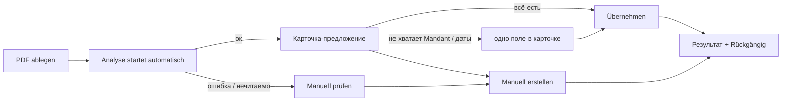

# Posteingang: предложение в один клик

Дата: 26.11.2026. Статус: черновик на согласование.
Макет: [2026-11-26-posteingang-one-click-mockup.html](2026-11-26-posteingang-one-click-mockup.html) (синтетические данные, открывается в браузере).
Заменяет экранную часть [2026-10-28-pdf-eingang-ux-design.md](../../plans/2026-10-28-pdf-eingang-ux-design.md).

## Зачем

Сейчас для письма с одной задачей нужно пройти три этапа и принять больше 10 решений:
применить анализ, явно выбрать Mandant с причиной, принять действие, выбрать
исполнителя или «позже» с причиной, поставить дату или «позже» с причиной,
подтвердить срок с основанием, поставить галочку проверки и только потом подтвердить.
Непонятно, что делать, и долго.

Нужно: загрузил PDF → получил предложение агента → **Übernehmen** или **Manuell erstellen**.

## Цели, не-цели, анти-цели

Цели:
- Обычное письмо закрывается одним кликом после короткого взгляда на карточку.
- Видно, что именно будет создано, до нажатия.
- Если чего-то не хватает, показывается ровно одно недостающее поле, а не форма.

Не-цели:
- Новая модель данных Incoming Letter / Run / Task.
- Распределение работы между несколькими сотрудниками.
- Изменение административного исправления (`create_correction`) — остаётся как есть.
- Отмена письма («Dokument verwerfen» с причиной, существующий `cancel`) остаётся: это выход для почты без Mandant (реклама, ошибочная загрузка). В новом интерфейсе — во вторичном меню «…».
- Изменение даты получения после загрузки: серверной операции нет, дата задаётся в диалоге загрузки, в карточке только показывается.

Анти-цели (провал, даже если работает):
- Срок из письма принимается без того, чтобы сотрудник видел цитату и страницу.
- Ошибка анализа или нечитаемый скан выглядят как «задача не нужна».
- В истории записаны проверки, которых никто не делал (например «Original geprüft»).
- Относительный срок («в течение месяца после Bekanntgabe») превращается в дату автоматически.

## Подходы

1. **Карточка-предложение + редактируемая карточка для ручного режима — выбрано.**
   Одна серверная операция подтверждения для обоих путей. Письмо закрывается и
   связывается с задачами одинаково. Старый трёхэтапный редактор удаляется.
2. Карточка + обычная форма Task ERP для ручного режима. Привычно, но письмо не
   закрывается и не связывается с задачей без дополнительного кода; две разные
   логики подтверждения. Отклонено пользователем.
3. Оставить трёхэтапный редактор и упростить поля. Не убирает главную проблему:
   слишком много шагов. Отклонено.

## Процесс

## Экран

Одна страница `/desk/posteingang`, три колонки на широком экране:

| Колонка | Содержимое |
| --- | --- |
| Слева, 260px | Зона «PDF hier ablegen» + кнопка «PDF auswählen» (кнопка обязательна: drag-and-drop не единственный способ). Список «Offen · N» и «Erledigt». У каждого письма отправитель, тип и один статус-чип. |
| Центр | Карточка выбранного письма. |
| Справа (по кнопке «Original») | PDF. Ссылки «S. 1 ansehen» прокручивают к странице и подсвечивают цитату. |

Статус-чипы в списке (всегда текст + значок, не только цвет):
`Vorschlag bereit` (синий) · `1 Angabe fehlt` (янтарный) · `Wird analysiert` (серый) ·
`Manuell prüfen` (красный) · `Erledigt` (зелёный).

Адаптивность:
- ≥1100px: список + карточка + PDF рядом.
- 680–1099px: PDF открывается вместо карточки с кнопкой «Zurück zum Vorschlag».
- <680px: сначала список; выбор письма открывает карточку с «Alle Dokumente»; кнопки на всю ширину.

### Карточка-предложение

Сверху вниз:
1. Заголовок: отправитель · тип · «Eingang: unbekannt · ändern»; название; одно предложение summary.
2. Полоса «Vorschlag des Assistenten · bitte kurz mit dem Original vergleichen».
3. **Mandant**: имя и почему агент так решил («Steuernummer … im Schreiben · S. 1»).
4. **Aufgabe**: название, описание и три факта:
   - *Frist laut Schreiben* — дата + «S. N ansehen»; ниже цитата из письма;
   - *Arbeitstermin* — дата + откуда взялась («5 Arbeitstage vor Frist»);
   - *Zuständig* — «Ich» + «hat hochgeladen».
5. Низ: **Übernehmen** (основная) · **Manuell erstellen**. Под кнопками одной строкой:
   «Erstellt 1 Aufgabe für Müller GmbH. Mit „Übernehmen“ bestätigen Sie Mandant, Frist und Aufgabe.»

Кнопка «Übernehmen» не блокируется заранее. Если чего-то не хватает, нажатие
прокручивает к полю, подсвечивает его и пишет под кнопкой «Noch offen: Mandant auswählen»
со ссылкой на поле. Блокируется только на время запроса.

### Состояния карточки

| Ситуация | Что видно | Основная кнопка |
| --- | --- | --- |
| Всё найдено | Mandant, задача, три факта | Übernehmen |
| Несколько кандидатов Mandant / несколько адресатов | Янтарный блок с вариантами (радиокнопки) + «Anderen Mandanten suchen». Ничего не выбрано заранее. | Übernehmen (после выбора) |
| Mandant не найден | Тот же блок с поиском | Übernehmen (после выбора) |
| Относительный срок | Вместо даты — поле «Frist selbst eintragen», цитата, «Wird nicht berechnet». После ввода Arbeitstermin считается сам. | Übernehmen (после ввода) |
| Несколько действий | Задачи с галочками (все включены), «2 von 2 ausgewählt» | «2 Aufgaben übernehmen»; если всё снято — «Ohne Aufgabe ablegen» |
| Агент не нашёл действий | «Keine Aufgabe nötig» + причина и страница | Ohne Aufgabe ablegen |
| Анализ идёт | Скелет карточки, «Meist unter einer Minute. Sie können inzwischen andere Dokumente bearbeiten.» | — |
| Анализ упал / нечитаемо | «Automatische Analyse fehlgeschlagen … Das heißt nicht, dass keine Aufgabe nötig ist.» | Manuell erstellen · Erneut analysieren |
| Готово | «1 Aufgabe erstellt», ссылки на Task, «Nächstes Dokument», «Rückgängig» | Nächstes Dokument |

### Manuell erstellen

Та же карточка становится формой, заполненной из предложения (или пустой, если
анализа нет): Mandant (поиск), Aufgabe, Beschreibung (optional), Frist laut Schreiben
(optional, подсказка «Nur ein Datum, das im Schreiben steht»), Arbeitstermin,
Zuständig. «+ Weitere Aufgabe». Внизу **Aufgabe erstellen** · Abbrechen · ссылка
«Ohne Aufgabe ablegen». Ошибки — под полем, с `aria-describedby`.

### Результат и отмена

После успеха: зелёный результат со ссылками на задачи, тост «1 Aufgabe erstellt ·
Rückgängig» (5 с, `aria-live="polite"`, фокус не забирает) и та же кнопка
«Rückgängig» в карточке. Следующее письмо открывается только по «Nächstes Dokument».

## Значения по умолчанию (мои решения, отменяют правило «ничего не подставлять» от 28.10)

- **Zuständig** — тот, кто загрузил PDF, если он активный сотрудник с доступом к Mandant; иначе текущий пользователь.
- **Arbeitstermin** — Frist минус 5 рабочих дней; не раньше сегодняшнего дня. Без Frist — сегодня + 7 дней.
  Рабочие дни: Пн–Пт минус праздники из Holiday List компании ERPNext, если он задан; иначе только выходные
  (тогда рядом с датой подсказка «ohne Feiertage»). Пример риска: срок 31.12 без праздников даёт 24.12.
- **Mandant** — предлагается только если ровно один кандидат и один адресат. Иначе выбор обязателен.
- **Eingangsdatum** — по-прежнему «unbekannt», меняется в заголовке.

## Предпосылка, которую решает владелец

Процесс «загрузил → сразу предложение» требует `auto_analysis_enabled = 1` и
`external_analysis_enabled = 1`, то есть автоматической отправки реальных PDF
клиентов в Mistral. По `docs/posteingang.md` готовность на `fake` не является
допуском провайдера и реальных документов; владелец отдельно утверждает провайдера,
сроки хранения, расходы и ответственных, а live-измерение AP-10B не проведено.
Один клик повышает цену ошибки агента. Пока допуска нет, карточка показывает
«Analyse starten» и «Manuell erstellen»; остальной дизайн от этого не меняется.

## Сервер

Существующие гарантии остаются: `expected_revision`, `request_key` (повтор без двойного
создания), права Operator/Customer/Task, проверка исполнителя, приватный PDF,
история событий, `validate_review`.

1. **Автоматическое применение анализа.** Успешный Run сразу становится
   предложением (то, что сейчас делает `apply_result`), пока письмо не тронуто
   человеком. Кнопка «Vorschläge übernehmen» исчезает.
2. **Новая операция `confirm_simple(letter, expected_revision, request_key, origin, customer, tasks[], no_task)`**
   в `posteingang_confirmation.py`. `origin` = `proposal` | `manual`.
   Сервер сам собирает полный review по текущему контракту и вызывает общую с
   `confirm` логику создания задач (вынести тело `confirm` во внутреннюю функцию):
   - `decision=accept` для выбранных задач, `reject` с причиной «Nicht ausgewählt» для снятых;
   - `assignment_decision=assigned`, `scheduling_decision=scheduled`;
   - `external_date_basis`, `customer_reason`, `no_actions_reason` — правдивые тексты:
     «Vorschlag übernommen (Fundstelle S. 2)» / «Manuell eingetragen» / «Vom Assistenten: keine Handlung erforderlich, übernommen»;
   - `human_verified=true` означает ровно нажатие кнопки; в событии сохраняются `origin`, пользователь и время.
3. **Несколько адресатов — изменение серверной политики, решает владелец.** Сейчас
   `confirm` отказывает (`MULTIPLE_ADDRESSEES`), а дизайн 28.10 отправлял такие письма
   в уточнение. Предложение: явный выбор одного Mandant сотрудником разрешает
   подтверждение, в историю пишется «Mehrere Empfänger, Mandant manuell gewählt».
   Альтернатива: оставить запрет; тогда такое письмо нельзя закрыть в Posteingang,
   карточка показывает «Schreiben an mehrere Empfänger» и объясняет почему.
4. **`undo_confirm(letter, request_key)`** — привязан к конкретному письму (не к
   выбранному в списке), тем же пользователем в течение 10 минут:
   созданные задачи, которые никто не менял, удаляются, письмо возвращается в
   Needs Review с прежним предложением. Если задачу уже меняли — отказ с подсказкой
   использовать «Korrektur anlegen». Отмена пишется в историю.
5. **Письма, уже лежащие в системе** (моё решение):
   - *Needs Clarification* — показываются в «Offen» с обычной карточкой; `confirm_simple` их принимает.
   - *Received* без Run (анализ выключен или не запускался) — карточка «Analyse starten» + «Manuell erstellen».
   - *Error* — состояние «Manuell prüfen».
   - *Needs Review* с правками человека в черновике — авто-применение нового Run их не перезаписывает;
     карточка открывается сразу в ручном режиме, заполненная из черновика.
   - `confirm_simple` принимает статусы Needs Review и Needs Clarification; Received/Error — только с `origin=manual`.
6. Удаляются: трёхэтапный редактор в `posteingang.js`, клиентские шаги и режим
   «Klärung erforderlich» в интерфейсе. Серверные `save_review`/`confirm` остаются
   для коррекций и совместимости.

## Доступность и визуальный стиль

Палитра и типографика — из дизайна 28.10 и Frappe (Inter, синий акцент `#2454D7`,
зелёный — результат, янтарный — нужна информация, красный — ошибка). Без
градиентов и «AI-магии»: агент упоминается одной строкой текста.
Цели ≥ 40–44px, видимый фокус, labels у всех полей, контраст текста ≥ 4.5:1,
анимации ≤ 0.7 с и отключаются при `prefers-reduced-motion`.

## Проверка

- Юнит-тесты `confirm_simple`: proposal/manual, несколько задач, снятие всех задач,
  относительный срок без даты (отказ), чужой исполнитель (отказ), повтор того же
  `request_key`, конфликт ревизии, несколько адресатов с явным выбором.
- `undo_confirm`: в окне и после, изменённая задача, чужой пользователь.
- Письма в статусах Needs Clarification / Received / Error / с черновиком проходят новый путь.
- Расчёт Arbeitstermin: выходные, Holiday List, срок раньше чем через 5 дней.
- Авто-применение Run: только пока письмо не тронуто.
- Один браузерный сценарий: загрузка синтетического PDF → Übernehmen → задача
  открывается; плюс 390px.

## Оставлено на реализацию

- Точное место авто-применения Run (job после анализа или при чтении состояния).
- Удаление vs отмена задач при `undo_confirm`, если удаление мешают ссылки Task.
- Переводы de/ru новых строк.
